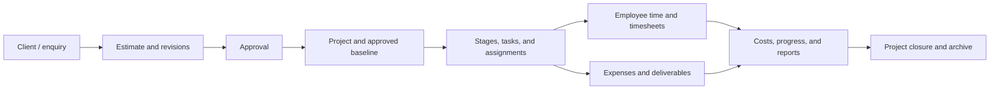
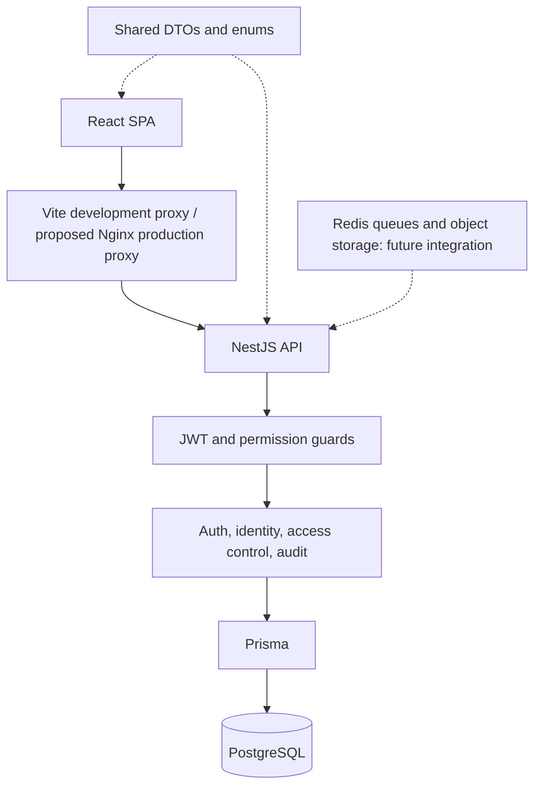

# EPMS — Project Understanding

Reviewed: 2 November 2026

> Docker follow-up: the repository now includes a root multi-stage `Dockerfile`, `.dockerignore`, and full-stack root Compose services for web, API, migrations, PostgreSQL, and Redis. See `DOCKER.md` for current container setup. Infrastructure limitations described below reflect the original review snapshot before that follow-up.

## 1. My understanding of the project

EPMS means **Engineering Project Management System**. It is intended to bring an engineering consultancy's client work, estimates, project plans, employee assignments, time records, costs, deliverables, and management reporting into one application.

The requirements describe an organization with more than 50 employees, approximately six teams, and 500–600 projects annually. Typical disciplines include HVAC, electrical, fire protection, plumbing, civil, and structural engineering. These are planning assumptions, rather than measured system capacity.

The current repository contains a TypeScript monorepo, a substantial identity and administration backend, and a React application shell with working login and password-change requests. Most operational project features remain planned or represented by placeholder screens.

**My assessment: this is a foundation-stage application with a Phase 1 backend implementation, rather than a complete operational EPMS.** The existing delivery reports describe an earlier checkpoint; code inspection is the basis for the implementation status below.

## 2. Review basis and limits

This document is based on the first-party application code, Prisma schema and migrations, seed definitions, shared contracts, infrastructure configuration, test suites, utility scripts, architecture documents, decision records, and requirements text in `frd_temp.md`.

The Word FRD is also present as `FUNCTIONAL REQUIREMENTS DOCUMENT (FRD).docx`. This review used the repository's text representation; equivalence between the text and Word versions was not independently verified. Dependencies, generated build artifacts, source maps, local credentials, and individual activity-log records are not treated as application design sources. No local secrets are reproduced here.

Static inspection establishes what the code attempts to do. It does not establish successful deployment, database migration status, browser behavior, or production readiness. Verification performed during this review is recorded at the end.

## 3. Intended business workflow



The diagram describes the intended product. Those business modules are largely absent from the current backend.

Key requirements that shape future implementation:

- Project names may repeat, but project codes must be unique.
- Tasks can have multiple employees; actual effort must remain attributable to each employee.
- Planned effort in hours and schedule duration are different quantities.
- Approved estimates and project baselines must retain history when revised.
- Each employee can have only one active timer across browsers and devices.
- Time intervals must not overlap for the same employee, including across projects, imports, and corrections. Adjacent intervals are allowed.
- Approved time and expenses feed financial calculations under agreed business rules.
- Approval authority, confidential information, and record access require server-side enforcement.
- Engineering documents need retained revisions and controlled approval/download behavior.
- Calendars, holidays, working days, and exceptions affect scheduling.

The initial product excludes full accounting, payroll, CAD/BIM authoring, automated engineering calculations, external client portals, and native mobile applications. Managing files produced by engineering tools is in scope.

## 4. Repository map

| Location | Responsibility |
|---|---|
| `apps/api` | NestJS REST API, Prisma schema, migrations, seed, backend tests |
| `apps/web` | React SPA, routes, layouts, auth state, HTTP client, feature pages |
| `packages/shared` | Framework-independent TypeScript DTO interfaces, enums, and error codes |
| `infrastructure/nginx/default.conf` | Same-origin API proxy and SPA hosting configuration |
| `docker-compose.yml` | Canonical local PostgreSQL and Redis services |
| `infrastructure/docker/docker-compose.yml` | Additional older Compose definition |
| `docs/decisions` | Accepted architecture decisions and unresolved assumptions |
| `docs/phase1` | Backend delivery report and supporting schema/seed/SQL copies |
| `docs/architecture/EPMS_STATUS_REPORT.md` | Historical implementation status report |
| `EPMS_Architecture.md` | Proposed broader architecture and phased delivery plan |
| `frd_temp.md` | Plain-text functional requirements |
| `scripts/generate-jwt-keys.js` | RSA key generation and root `.env` update utility |
| `tracker.py`, `activity_log.csv` | Separate Windows GstarCAD process/window tracking experiment |

The active database schema is `apps/api/prisma/schema.prisma`; schema and seed files under `docs/phase1` are supporting documentation rather than the runtime source of truth.

## 5. Architecture and technology

EPMS uses npm workspaces for three packages: `@epms/web`, `@epms/api`, and `@epms/shared`.

| Layer | Main technologies |
|---|---|
| Browser | React 18, React Router 6, Vite 6, Tailwind CSS 3 |
| Browser data access | Axios, TanStack Query 5 |
| API | NestJS 10, Express, TypeScript |
| Persistence | PostgreSQL 16, Prisma 6 |
| Authentication | Passport JWT, RS256 JWTs, Argon2id password hashes |
| Operational support | Pino logging, Helmet, Nest throttler, Terminus health checks |
| Future background work | Redis 7, BullMQ and ExcelJS dependencies |
| Tests | Jest and ts-jest for API; Vitest, jsdom, Testing Library tooling for web |

Dependencies such as BullMQ, ExcelJS, React Hook Form, Zod, and TanStack Table do not by themselves indicate completed functionality. Shared validation schemas are mentioned in design material, but the shared source currently centers on interfaces and enums.



This is a modular monolith. There is one API application and database, with internal modules rather than separately deployed business services. Single-company deployment is an architectural assumption.

## 6. Current implementation status

| Capability | Backend | Frontend |
|---|---|---|
| Login and token refresh | Implemented | Connected |
| Required password change | Implemented | Connected; login redirects when required |
| Logout and logout-all | Implemented endpoints | Current sign-out button only clears local auth state |
| Current user profile and permissions | `/auth/me` implemented | Auth context does not retain full user/permission context |
| Employee administration | Implemented | No complete administration screens |
| Departments, designations, teams | Implemented | Team screen is informational |
| Roles and permission matrix | Implemented | Settings screen is a placeholder |
| Audit history | Implemented reads and writes | No audit search UI |
| Self-service forgotten password | No corresponding workflow found | Form only shows a local success message |
| Clients and opportunities | No business models/controllers found | No complete workflow |
| Estimates and approvals | Permission catalog and shared enums only | No complete workflow |
| Projects, stages, tasks, baselines | Permission catalog and shared types/enums only | Mock project list and placeholder detail page |
| Timers and timesheets | No persistence/workflow implementation found | Placeholder page |
| Expenses and finance | Permission catalog and shared enums only | Demo dashboard values |
| Documents and storage | Storage interface only | No complete workflow |
| Notifications | Channel interface and logging stub | No complete workflow |
| Reports, imports, exports | Dependencies and permissions prepared | Placeholder page |
| Calendars and master configuration | Permissions prepared | No complete workflow |

The dashboard's project count, hours, team count, and invoice amount are hard-coded. They are not calculated from stored business records. The invoice card should not be read as evidence of an accounting module.

## 7. Backend behavior

### Application bootstrap

`apps/api/src/main.ts` establishes the `/api` prefix and URI versioning, explicit credentialed CORS using `APP_URL`, Helmet headers, cookie parsing, and global DTO validation. Unknown DTO fields are rejected. Development Swagger documentation is exposed at `/api/docs`.

`AppModule` registers configuration validation, structured logging, throttling, event emitter infrastructure, scheduler infrastructure, health checks, Prisma, and the implemented domain modules. Scheduler and event-emitter registration do not establish completed business jobs or event workflows.

Global guards run throttling, authentication, and permission checks. Routes marked `@Public()` bypass authentication and permission checks. Protected endpoints without permission metadata still require authentication but do not receive a feature-specific permission check.

Controllers declare both version-neutral and version `1` routes. Use `/api/v1` as the browser-facing API base; the refresh cookie is specifically scoped to `/api/v1/auth`.

### API surface

Paths below are relative to `/api/v1`.

| Area | Existing operations |
|---|---|
| Authentication | `POST /auth/login`, `/refresh`, `/logout`, `/logout-all`, `/change-password`; `GET /auth/me` |
| Employees | `GET /employees`, `POST /employees`, `GET /employees/:id`, `PATCH /employees/:id` |
| Account administration | Employee deactivate/reactivate, role assignment, password reset, unlock, session listing and family revocation |
| Organization | List/detail/create/update/deactivate departments, designations, and teams under `/organization` |
| Access control | Permission catalog, role list/detail/create/duplicate/update/deactivate |
| Audit | `GET /audit-logs` with pagination and actor/entity/action/date filters |
| Health | `GET /health` for liveness; `GET /health/ready` for database connectivity |

### Employee and organization management

An employee record also holds the login account. Creation normalizes email, hashes a generated temporary password, sets a required password change, and assigns supplied active roles or defaults to `EMPLOYEE`. The raw temporary password is returned to the administrator.

Generated employee codes use `EMP-####`; a PostgreSQL transaction-level advisory lock serializes automatic code allocation. The bootstrap administrator uses `EMP-0001`.

Employee reads support search, pagination, department/status/role filters, own-record restriction, and masking of phone/joining date unless viewing self or holding the sensitive-data permission. Deactivation revokes refresh sessions. There are checks intended to preserve the last active system administrator.

Departments and designations are reusable organization records. Teams belong to a department, may have a lead, and have multiple members. Team updates can replace the membership set. Deactivation preserves records rather than deleting their history.

## 8. Authentication and authorization

### Session flow

1. Login verifies the employee's email/password, active status, lockout, and temporary-password expiry.
2. A successful login creates a refresh-token family and a signed RS256 access token.
3. The browser stores the access token only in JavaScript memory and sends it as a Bearer token.
4. The server sets a refresh cookie with `HttpOnly`, `SameSite=Lax`, path `/api/v1/auth`, and `Secure` in production.
5. A refresh exchanges the old token for a new refresh token and access token. Only a SHA-256 hash of the refresh token is stored in PostgreSQL.
6. Reusing a rotated or revoked token triggers family revocation and an audit event.
7. JWT validation reads employee state and resolves role grants from the database on each protected request.

The browser deduplicates simultaneous refresh attempts through one shared promise, retries failed requests once, and clears auth/query state if refresh fails. Reloading the page attempts session restoration through the cookie.

Current default policies are a 15-minute access token, seven-day refresh lifetime, five failed attempts before lockout, 15-minute lockout, five concurrent session families, and 72-hour temporary-password validity. Environment variables configure these values.

Password policy requires at least 12 characters, uppercase, lowercase, a digit, and a symbol. Password-change code verifies the current password and checks recent password hashes before updating the account and audit history.

### Roles and scopes

The seed defines seven role templates:

| Role code | Intended responsibility |
|---|---|
| `SYSTEM_ADMIN` | Accounts, organization, roles, configuration, audit |
| `MANAGEMENT` | Organization-wide operational and financial visibility |
| `PROJECT_MANAGER` | Project ownership, scope, budget, delivery |
| `PROJECT_COORDINATOR` | Cross-team schedule and assignments |
| `TEAM_LEADER` | Team delivery and timesheet oversight |
| `EMPLOYEE` | Own work, time, submissions, and assigned project access |
| `FINANCE` | Financial records, rates, expenses, reporting |

System administration does not automatically grant financial/project-content access in the seed. Leaders and managers are expected to receive `EMPLOYEE` as an additional role when needed.

Permissions are database records such as `employees.view` or `timesheets.approve`. Effective permissions combine all active roles. For the same key, the current resolver chooses the highest ranked scope:

`OWN < TEAM < DEPARTMENT < ASSIGNED < ALL`

This ordering is an implementation convention. Team, department, and assigned-project memberships are different sets in practice; ranking scopes does not prove record-level authorization. Services must enforce actual membership constraints.

System roles cannot be deactivated. Custom roles cannot be deactivated while active employees hold them. The system administrator role must retain four core `ALL` grants. A self-approval helper exists, but business approval workflows that use it remain future work.

## 9. Database model

The active schema has 13 models:

| Models | Purpose |
|---|---|
| `Employee` | Profile, reporting manager, organization references, account/security state |
| `Department`, `Designation` | Organization classification |
| `Team`, `TeamMember` | Department teams, leadership, employee memberships |
| `Role`, `Permission`, `RolePermission`, `EmployeeRole` | Configurable multi-role authorization, scoped grants, optional approval limits |
| `RefreshToken` | Hashed rotating tokens grouped into session families |
| `PasswordHistory` | Previous password hashes |
| `AccountLockout` | Lockout history and administrator release information |
| `AuditLog` | Actor, action, entity, before/after values, outcome, request metadata |

Most entity IDs use UUIDs. Unique keys include employee code, employee email, organization codes, role code, permission key, and refresh-token hash. Membership and permission-assignment tables use composite keys.

There are no active Prisma models yet for clients, projects, estimates, tasks, time entries, timers, timesheets, expenses, documents, calendars, or persistent notifications. Shared types and seeded permissions for those concepts are preparation for later modules.

The two migrations create the identity foundation and install audit protection. Database triggers reject audit updates, deletes, and truncation. Audit payloads are recursively sanitized for a defined set of credential-related field names. Transactional audit failures abort the associated transaction; audit failures outside a transaction are logged and swallowed.

The seed uses upserts and preserves existing grant rows. However, rerunning it can recreate a default grant that an administrator deleted, because missing default mappings are inserted again.

## 10. Frontend structure and behavior

The SPA uses lazy-loaded feature pages and React Router. Public routes include `/login` and `/forgot-password`. Protected routes include `/change-password`, `/dashboard`, `/projects`, `/projects/:projectId`, `/timesheets`, `/team`, `/reports`, and `/settings`.

`ProtectedRoute` waits for initial restoration and redirects unauthenticated users to login while retaining the requested location. It currently checks authentication status rather than feature permissions. Navigation items are static.

`AuthProvider` tracks `loading`, `authenticated`, or `unauthenticated`, and handles session-expiry events. It does not currently expose the current employee, roles, or permission map to feature components. Login uses the returned user only to decide whether to redirect to password change.

The shared HTTP client adds Bearer tokens and request IDs, sets timeouts, normalizes errors into `ApiError`, and manages refresh/retry behavior. Access tokens are not persisted in browser storage. TanStack Query is provided centrally for future server-state queries.

Error boundaries, toast infrastructure, Tailwind theme/style configuration, and shared API barrels form reusable UI foundations. Most feature pages do not yet fetch operational data.

## 11. Infrastructure and local development

ADR-001 fixes the root `docker-compose.yml` as the canonical Compose file and `infrastructure/nginx/default.conf` as the reverse-proxy location. Root Compose starts PostgreSQL and Redis, binds their ports to loopback, and persists their data in Docker volumes. The older nested Compose file uses broader port bindings; the two configurations should not be treated as interchangeable.

The Vite development server uses port 5173 and proxies `/api` to NestJS on port 3000. Nginx is configured to serve SPA assets and forward API requests to an `api:3000` upstream. The repository does not provide a complete container deployment for that upstream: the current Compose services are only database and Redis. TLS and application deployment still need infrastructure work.

Typical setup, inferred from scripts and configuration:

```powershell
npm install
Copy-Item .env.example .env
# Set local configuration and administrator credentials.
node scripts/generate-jwt-keys.js
docker compose up -d
npm run build --workspace=packages/shared
npm run prisma:generate --workspace=apps/api
npm run prisma:migrate:deploy --workspace=apps/api
npm run prisma:seed --workspace=apps/api
# Run the next commands in separate terminals:
npm run dev:api
npm run dev:web
```

These are setup instructions, not commands executed during this review. Do not overwrite an existing configured `.env`. The key-generation utility replaces existing JWT keys when run.

Environment loading needs attention: the seed explicitly looks for the root `.env`, whereas the API configuration uses Nest's default environment-file lookup. Workspace commands may execute with `apps/api` as their current directory. Confirm the actual environment source for API startup and Prisma commands rather than assuming the root `.env` is loaded by every tool.

The API TypeScript configuration resolves `@epms/shared` through its `dist` directory, while Vite resolves shared source directly. Building shared before the API avoids relying on old or missing shared artifacts. The root build command follows workspace ordering and does not explicitly encode this dependency.

## 12. Observed gaps and issues to resolve

These are code-review findings. They have not all been reproduced through running HTTP or browser scenarios.

| Finding | Evidence and implication |
|---|---|
| Browser sign-out does not call server logout | `AppLayout` invokes `markUnauthenticated`, which clears memory/cache but leaves the refresh cookie and server family active. A reload can restore that session. |
| Access JWTs are not checked against family revocation | JWT strategy checks employee status and current permissions but does not check whether its refresh family was revoked. Logout/session revocation does not immediately invalidate an already issued access token. |
| Record scopes are incomplete | Employee reads distinguish only `OWN` from other scopes. `TEAM`, `DEPARTMENT`, and `ASSIGNED` grants are not filtered to their corresponding employee sets. A scope-resolver interface exists, but complete resource filtering is not wired in. |
| Refresh rotation has a concurrency gap | The old token is read before the transaction and then updated unconditionally. Parallel requests may both pass the initial unrotated check. Browser single-flight only coordinates one JS runtime. |
| Standard exceptions can lose application error codes | The exception filter reads `body.error` for ordinary Nest exceptions, while many services pass `{ code, message }`. Clients may receive `HTTP_ERROR` rather than the intended application code. |
| Forgotten-password confirmation is simulated | The form changes local state without an API request or email dispatch. |
| User/permission state is missing from frontend context | Permission-aware navigation, feature guards, and consistent forced-password-change handling after restoration remain incomplete. |
| Some session revocations sit outside the enclosing transaction | Employee deactivation/password-reset transactions call a token service that uses the root Prisma client, so revocation and profile/audit changes do not share one atomic transaction. |
| Administrator and session-limit checks need concurrent validation | Several checks count/read records before mutation. Unit tests do not establish that simultaneous operations preserve those invariants. |
| Query and route validation is uneven | Several controller parameters are manually parsed strings rather than validated query DTOs/UUID pipes. Invalid pagination, dates, status, or IDs need explicit handling. |
| Audit completeness differs by call site | The writer accepts request IDs, but many callers omit them. Nontransactional audit writes can fail without failing the operation. |
| Throttling configuration needs intent checked | Both named throttlers are globally registered; there is no clear per-auth-route override in the inspected controllers. The declared `auth` name alone does not isolate a limiter to auth endpoints. |
| Provider features remain scaffolding | Redis configuration and dependencies exist, but no complete queue processors, object-storage implementation, email delivery, or notification persistence were found. |
| Historical documents disagree | Role proposals, financial representation, phase numbering, and completion claims vary. The current seed/schema/code should guide implementation status until the requirements are reconciled. |

These gaps do not require changing the overall stack. They do require focused integration and concurrency verification before treating the foundation as complete.

## 13. Auxiliary scripts and repository hygiene

`tracker.py` is a Windows-only experiment using `psutil`, `win32gui`, and `win32process`. It polls `gcad.exe` every second and appends process-start, process-stop, and foreground-window/title events to a fixed local CSV path. It has no API, employee, project, or timesheet integration. Foreground-window changes are not an implemented measure of billable work duration.

`requieremen.js` contains JavaScript exercises, including async execution ordering. It is unrelated to the product workflow.

`apps/web/src/features/dashboard/demoComponent.js` is a standalone fetch example targeting `/api/projects`; it is not the routed project feature and does not establish a working projects endpoint.

`apps/api/fix-admin.ts` and `.js` are account repair scripts. They alter credentials and account state outside the usual audited administration workflow. The JavaScript version calls `prisma.disconnect()` rather than Prisma's `$disconnect()`. They should not be confused with standard setup or normal application behavior.

Compiled JavaScript/source maps exist alongside shared TypeScript source, and supporting schema/seed copies exist under documentation. Clarifying generated artifacts and authoritative files would reduce confusion for future contributors.

## 14. Tests and verification

Existing API suites cover password policy/history, self-approval prevention, permission union/scope ranking, role protection, and token rotation/reuse/session-limit behavior using mocks. The web suite covers HTTP headers, refresh/retry, concurrent 401 deduplication, session expiry, and error normalization.

These suites provide useful unit-level checks. They do not prove real-database transaction behavior, browser cookie behavior, end-to-end administration, scope enforcement, deployment, or future timer/time-overlap guarantees.

The API exposes a `test:e2e` script referencing `test/jest-e2e.json`, but that configuration is absent from the inspected first-party file inventory. Do not assume an end-to-end suite is available merely because the script exists.

Review verification:

- `npm run typecheck`: passed for web, API, and shared workspaces.
- `npm run test`: passed; web has 8 tests in one suite, API has 18 tests in five suites (26 total). Jest emitted warnings about compiling shared `.js` files without `allowJs`; the run still exited successfully.
- Database migrations, seed, live API endpoints, and browser flows were not executed.
- Full lint/build verification was not run during this documentation review. Earlier reports claiming `npm run verify` passed are historical evidence only.
- Git status could not be inspected because `git` was unavailable on this shell's PATH.

## 15. Suggested implementation sequence

1. Finish and verify the identity foundation: real logout wiring, current-user context, record filtering, error-code propagation, session invalidation expectations, and concurrent rotation/admin protections.
2. Add employee, organization, role-matrix, session, and audit administration screens against the existing APIs.
3. Confirm outstanding rules for project numbering, estimate approval, calendars, timesheet periods, corrections, costing, profitability, document retention, and recovery targets.
4. Implement clients, estimates, approved versions/baselines, projects, stages, tasks, dependencies, and assignments.
5. Implement database-enforced timer exclusivity and overlap-safe time entry, then timesheet review and approval with concurrency tests.
6. Implement expenses and historical labor-cost rates before deriving financial summaries.
7. Add document providers/versioning, durable notifications, import/export jobs, and real reporting.
8. Complete deployment packaging, backup/restore validation, security/performance testing, and user acceptance.

This sequence reflects current dependencies and observed code, rather than treating inconsistent phase numbers across older documents as a fixed delivery contract.
